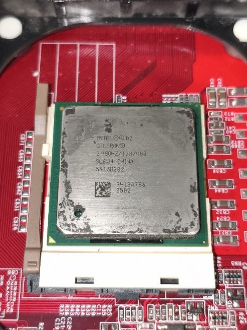
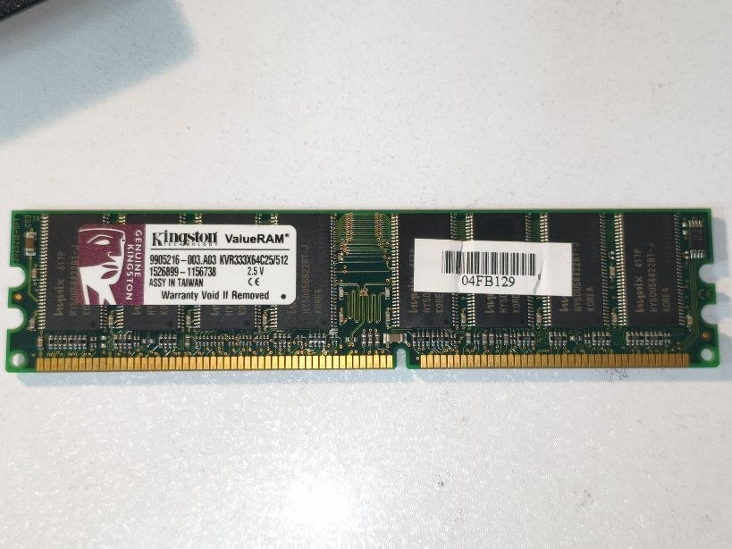
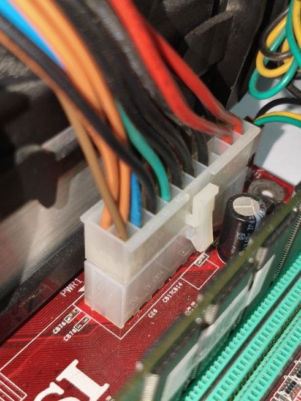
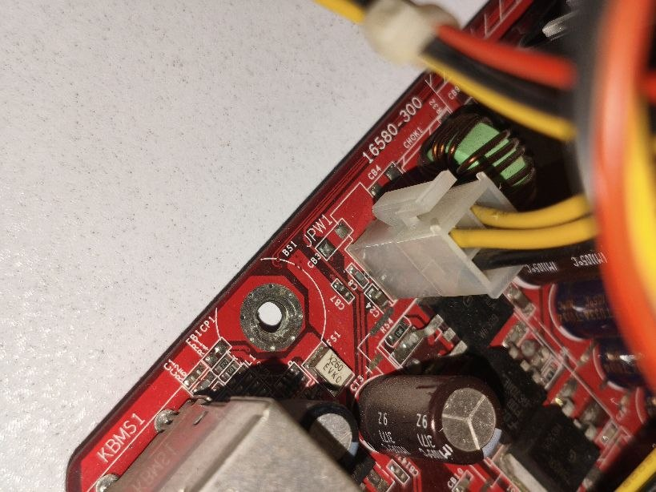
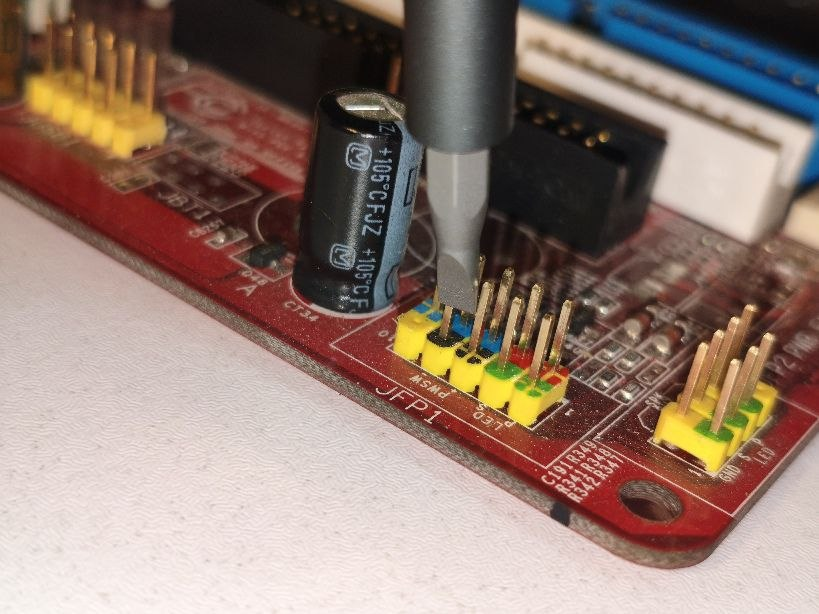
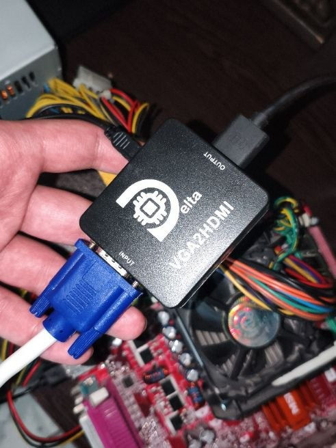
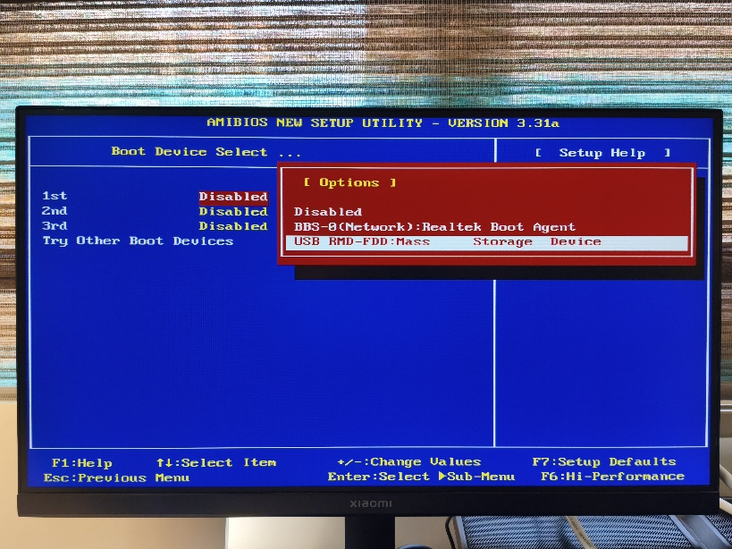
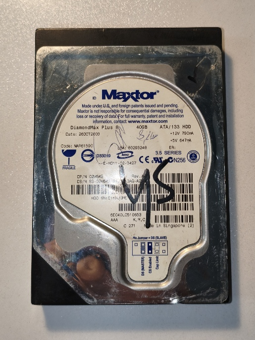
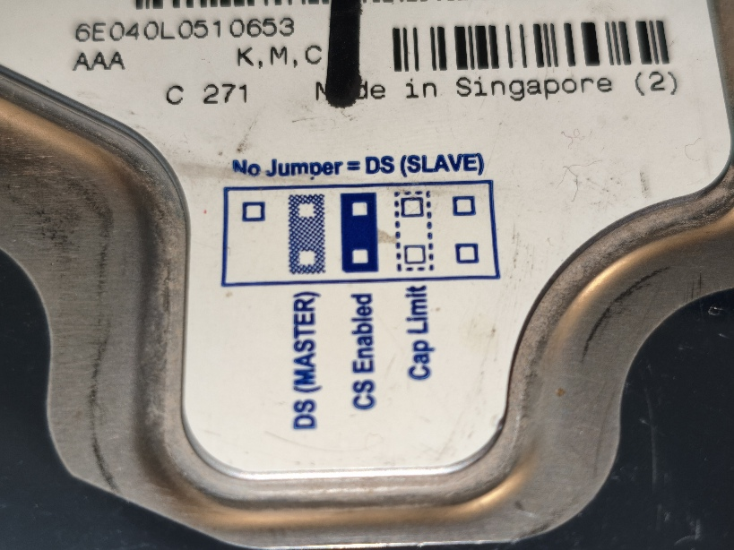
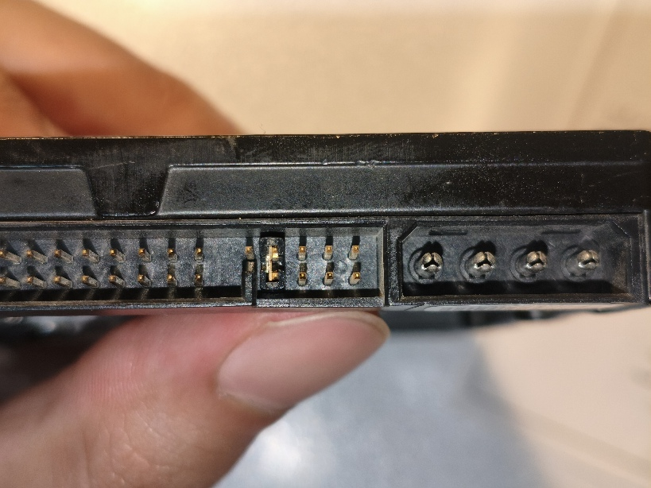

+++
title = "making a crappy theft-detector via an old motherbord"
date = "2026-09-17T18:00:00+03:30"
dateFormat = "06-01-02" # per-post date formatting‍
author = "yusef"
authorTwitter = "" # do not include @
cover = "cover.jpg"
tags = ["failed", "hardware", "linux", "motherboard"]
description = "the most sophisticated theft-detector ever using a 2004 msi motherboard"
showFullContent = false
readingTime = true
hideComments = false
draft = true
+++

someone gave me a msi 845pe for free to do whatever i want with it, i decided to install a lightweight linux, plug a web-cam and make it a theft-detector, so when something suddenly moves, a telegram-bot would send me a warning-message.

it had a intel-celeron 2.40ghz/128/400 cpu that i renewed its thermal paste with arctic-mx4 alogside its chipset as well.

it also had a 512mb kingston ddr1 inside one of its two 1gb-max ram slots. enough for my lightweight task and os. 


i bought a power-cord for 2$ to plug its 220v-to-300w power-supply to wall, then connected its main-20pin and cpu-4pin to the motherboard. 



now i can turn it on via short-circuting pwsw in jfp1 using my screw-driver


i made sure it boots even without an os using a vga cable + vga to hdmi


check if the motherborad support booting from usb in bios

i thought id did, but it didnt. only floppy disk

buy a used 40gb ide-hdd for 2$ to directly put linux on it


to do that, buy an usb-to-ide cable for 10$ to connect the hdd to laptop.
also, put it on master-mode

download antiX-26-Core 32bit and install it permanently onto the hdd. how? by temporarily booting the antiX ISO on the T490:
first, unmount the USB partitions:
write the iso on the usb:
```
[jfryusef@archlinux ~]$ sudo dd if=~/antiX-26_386-core.iso of=/dev/sda bs=4M status=progress conv=fsync
143+1 records in
143+1 records out
602931200 bytes (603 MB, 575 MiB) copied, 120.791 s, 5.0 MB/s
```
i booted the antix linux on the t490